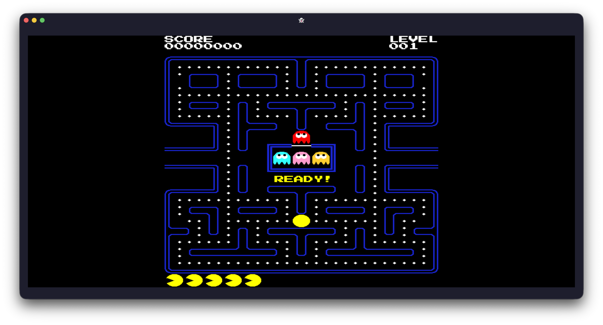
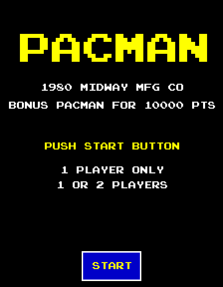

<!-- markdownlint-disable MD013 -->
# PacMan

[](https://sonarcloud.io/summary/new_code?id=stephenlclarke_pacman)
[](https://sonarcloud.io/summary/new_code?id=stephenlclarke_pacman)
[](https://sonarcloud.io/summary/new_code?id=stephenlclarke_pacman)
[](https://sonarcloud.io/summary/new_code?id=stephenlclarke_pacman)
[](https://sonarcloud.io/summary/new_code?id=stephenlclarke_pacman)
[](https://sonarcloud.io/summary/new_code?id=stephenlclarke_pacman)
[](https://sonarcloud.io/summary/new_code?id=stephenlclarke_pacman)
[](https://sonarcloud.io/summary/new_code?id=stephenlclarke_pacman)
[](https://sonarcloud.io/summary/new_code?id=stephenlclarke_pacman)
[](https://sonarcloud.io/summary/new_code?id=stephenlclarke_pacman)
[](https://sonarcloud.io/summary/new_code?id=stephenlclarke_pacman)


---

This is a Rust implementation of Pacman rendered in a native window with `wgpu` and `winit`. The game opens its own window.

[Download released binaries](https://github.com/stephenlclarke/pacman/releases) for macOS ARM64 and Windows x86-64. See the [download and launch instructions](#download-a-binary-from-github) for the correct archive, checksum verification, and extraction steps.



<!-- markdownlint-disable MD033 -->
<p align="center">
  
</p>
<!-- markdownlint-enable MD033 -->

## Build and Run

Version `v1.1.0` includes GPU scene composition and native desktop release packages. Start a source checkout with:

```sh
git clone --branch v1.1.0 https://github.com/stephenlclarke/pacman.git
cd pacman
cargo build --locked
cargo run --release
```

Use the current stable Rust toolchain. A graphical desktop session and a GPU supported by `wgpu` are required for interactive play. Graphics, sounds, and arcade defaults are embedded in the binary, so an installed game can run from any working directory.

Run targets:

- `cargo run`
- `make run`
- `cargo build --locked`
- `cargo test --all-targets`
- `cargo fmt --check`
- `cargo clippy --all-targets -- -D warnings`
- `make ci`
- `make coverage`
- `make sq-ci`
- `make sq`
- `cargo run --example generate_start_sequence_gif`
- `cargo run --example headless_autopilot`

Run `cargo run` to launch the game in its own window. `cargo run -- --help` prints the supported launch options and controls.

## Controls

| Input | Action |
| --- | --- |
| Arrow keys / WASD | Queue Pacman's next direction |
| Enter | Start from the title or scoring screen |
| Left mouse click | Activate the on-screen start button |
| Space | Pause or resume during gameplay |
| Q / Esc / close window | Quit |

Keyboard and mouse input are handled by `winit`. Resizing preserves the game's aspect ratio and centers the scene in the window.

## Rendering

`src/app.rs` runs the native `winit` event loop and fixed-timestep game updates. It sends scene descriptions directly to `src/gpu_scene.rs`: cached maze, sprite, and text textures are drawn as instanced quads, while WGSL shaders rasterize and blend the shapes on the GPU. `src/wgpu_graphics.rs` presents the completed GPU texture with correct sRGB output, aspect-preserving scaling, and FIFO presentation when available. It also handles resizing and surface recovery.

Game logic, asset decoding, glyph image creation, and draw-command preparation remain on the CPU. Live play no longer rasterizes a complete RGBA frame on the CPU or uploads one every frame. Unchanged image assets stay in GPU memory; expired dynamic images leave the cache. Integrated and discrete GPUs are supported through wgpu, with a high-performance adapter preference. If no supported adapter can be created, startup reports an error.

The implementation follows [Defender](https://github.com/stephenlclarke/defender)'s native window and GPU rendering approach. `src/render.rs` remains a software reference for deterministic tests and generated README media, and supplies shared viewport transforms. `make gpu-test` compares actual GPU readback with the software reference.

## Install

Install the wgpu build using Homebrew:

```sh
brew tap stephenlclarke/tap
brew install stephenlclarke/tap/pacman
pacman
```

Upgrade an existing installation and check the installed command:

```sh
brew update
brew upgrade stephenlclarke/tap/pacman
brew test stephenlclarke/tap/pacman
pacman --help
```

The formula builds from source with Homebrew's Rust dependency and installs the `pacman` command. Its currently published pin has wgpu presentation with CPU frame composition; use the source branch above to try the new GPU scene composer before the tap is updated. The published formula version `1.0.0_1` pins wgpu commit `cd49a1a0f407801cdc492ba61b4cdc5f8afb42c5` with a verified SHA256. The optional `brew install --HEAD stephenlclarke/tap/pacman` follows the `wgpu` branch. Linux builds also require the formula's `alsa-lib` and `pkgconf` dependencies. Interactive play requires a graphical desktop and a GPU supported by wgpu; the help and formula test run without opening a window.

Remove the Homebrew installation with `brew uninstall stephenlclarke/tap/pacman`. Scores and customisations in `~/.xyzzy/pacman/` remain available for a later installation.

Install directly from git with Cargo:

- `cargo install --git https://github.com/stephenlclarke/pacman --tag v1.1.0 pacman`

`cargo install` builds with Cargo's release profile by default. Do not pass `--debug` unless you explicitly want a slower debug build.

After installation, run the game with:

- `pacman`

### Download a Binary from GitHub

Open the [v1.1.0 release](https://github.com/stephenlclarke/pacman/releases/tag/v1.1.0) or [all GitHub Releases](https://github.com/stephenlclarke/pacman/releases) and download the archive for your computer. The publication process is described in [Releasing](docs/RELEASING.md). These archives contain the executable and this README; Rust and Cargo are not needed to run them.

| Platform | Release asset |
| --- | --- |
| macOS Apple Silicon (ARM64) | [macOS ARM64 archive](https://github.com/stephenlclarke/pacman/releases/download/v1.1.0/pacman-v1.1.0-aarch64-apple-darwin.tar.gz) |
| Windows Intel/AMD (x86-64) | [Windows x86-64 archive](https://github.com/stephenlclarke/pacman/releases/download/v1.1.0/pacman-v1.1.0-x86_64-pc-windows-msvc.zip) |
| Linux Intel/AMD (x86-64) | [Linux x86-64 archive](https://github.com/stephenlclarke/pacman/releases/download/v1.1.0/pacman-v1.1.0-x86_64-unknown-linux-gnu.tar.gz) |
| Linux ARM64 | [Linux ARM64 archive](https://github.com/stephenlclarke/pacman/releases/download/v1.1.0/pacman-v1.1.0-aarch64-unknown-linux-gnu.tar.gz) |

Windows x86 means the 64-bit `x86_64` target here; 32-bit Windows is not built. macOS uses the native Metal backend through wgpu. Windows needs a working wgpu-compatible graphics driver. These are command-line executables that open a game window, not installers or macOS `.app` bundles. They are not Developer ID signed or notarized, and the Windows executable is not Authenticode signed.

Download the matching archive and [SHA256 checksum manifest](https://github.com/stephenlclarke/pacman/releases/download/v1.1.0/pacman-v1.1.0-SHA256SUMS.txt) from the same release. The examples below use `v1.1.0`; substitute the selected version when installing another release. On macOS, compare the output of `shasum -a 256 pacman-v1.1.0-aarch64-apple-darwin.tar.gz` with the matching manifest entry, then extract and launch:

```sh
tar -xzf pacman-v1.1.0-aarch64-apple-darwin.tar.gz
./pacman --help
./pacman
```

On Windows, compare `Get-FileHash .\pacman-v1.1.0-x86_64-pc-windows-msvc.zip -Algorithm SHA256` with the matching manifest entry. In PowerShell, extract and launch:

```powershell
Expand-Archive .\pacman-v1.1.0-x86_64-pc-windows-msvc.zip -DestinationPath .\pacman
.\pacman\pacman.exe --help
.\pacman\pacman.exe
```

Version-tag builds publish the archives and checksum manifest to GitHub Releases. Before a version is tagged, tested builds can be downloaded from the [Release workflow's Actions artifacts](https://github.com/stephenlclarke/pacman/actions/workflows/release.yml). Branch, pull-request, and manual runs upload build artifacts without publishing a version.

Notes:

- Scores and overrides use `$HOME/.xyzzy/pacman/` when `HOME` is set. Otherwise, including a typical Windows PowerShell session, they use `.xyzzy/pacman/` under the current working directory. Set `PACMAN_DATA_DIR` to a fixed writable directory to keep the same data when launching from different folders.
- If `pacman` is not found after a Cargo installation, ensure `~/.cargo/bin` is on your `PATH`. For Homebrew, load the shell environment shown by `brew shellenv`.
- If multiple installations exist, use `command -v pacman` to see which executable your shell launches. A stale Cargo binary can take precedence over the Homebrew installation.

## Validation and Troubleshooting

`make ci` checks formatting, runs all-target Rust tests and release packaging tests, and runs Clippy with warnings rejected. Packaging checks require Python 3. Run `make workflow-lint` with `actionlint` installed to check GitHub Actions, and `make docs-lint` with `markdownlint` installed to check all maintained Markdown. Two expensive autopilot simulations and one native GPU parity test are ignored by default. Run `make gpu-test` on a machine with a working GPU to compare title, gameplay, shapes, texture scaling, transparency, and cache behavior against software-rendered frames. To run only the expensive autopilot tests, use `cargo test --lib autopilot -- --ignored`. Standard tests do not prove a live GPU window works.

For a bounded headless game simulation without a window:

```sh
cargo run --release --example headless_autopilot -- 0 1 1000
```

Arguments are the starting seed, number of runs, and maximum steps per run. Generate README attract-sequence media with `cargo run --example generate_start_sequence_gif`; it writes `docs/start-sequence.gif` using the software renderer and accepts an optional output path.

If a GPU adapter or surface cannot be created, run the game in a graphical desktop session with working graphics drivers. `pacman --help` verifies the executable independently of the graphics stack. Audio uses the default output device; if none is available, the game continues without sound. On Linux, the release workflow installs `libasound2-dev` for source builds; graphical and audio runtime checks remain necessary.

See [Releasing](docs/RELEASING.md) for local packaging checks, workflow triggers, release asset names, checksums, and the tag publication procedure.

## SonarQube

- `make sq-ci` generates the Cobertura coverage report used by the SonarCloud
  workflow in CI.
- `make sq` runs the same coverage step locally and then invokes
  `sonar-scanner`.
- Local SonarQube scans require `cargo-llvm-cov`, the stable toolchain's `llvm-tools-preview` component, `sonar-scanner`, and a `SONAR_TOKEN` environment variable.

## XYZZY Mode

After starting the game, type `X`, `Y`, `Z`, `Z`, `Y` to toggle `XYZZY` mode on
or off. Pacman blinks three times when the mode changes.

Letter-key controls accept either upper- or lower-case input.

Extra keys while `xyzzy` mode is active:

- `A`: toggle autopilot. This will route Pacman around the maze to clear pellets,
  pick up fruit, chase frightened ghosts when it is worthwhile, and delay power
  pellets until they are useful. Autopilot turns off automatically when the
  level has no pellets left.
- `F`: toggle forced freight mode for the ghosts.
- `R`: reset all ghosts back to their starting positions.
- `T`: teleport Pacman to the safest valid node on the map.

## ROM References

These online references have been useful while translating the Midway Pac-Man
ROMs into native Rust rather than emulating the Z80 code directly:

- [pacmancode.com](https://pacmancode.com): original lesson sequence this repo
  started from before the arcade-ROM translation work.
- [Midway Pacman ROMS](https://www.retrostic.com/roms/mame/pac-man-40808):
  Original Midway Arcade Pacman ROMS
- [Pacman hardware](https://www.walkofmind.com/programming/pie/hardware.htm):
  CPU/video memory map, palette PROM layout, sprite registers, and screen
  rotation details.
- [Pacman character definitions](https://walkofmind.com/programming/pie/char_defs.htm):
  character ROM byte layout and rotated tile decoding details.
- [Characters, sprites and colours](https://pacmanc.blogspot.com/2024/05/characters-sprites-and-colours.html):
  practical notes on character ranges, sprite ranges, maze wall characters,
  tunnel and ghost-house color markers, and fruit/icon character tables.
- [Pac-Man Emulation Guide](https://www.lomont.org/software/games/pacman/PacmanEmulation.pdf):
  hardware-oriented reference for palettes, video layout, sprite ordering, and
  general ROM structure.

## Customisation

Arcade defaults ship in `assets/arcade/`. Copy the files you want to change
into `~/.xyzzy/pacman/` to override them locally. Key/value files are merged on
top of the embedded defaults, so you only need to include the keys you want to
change. Layout files are replaced whole. If `PACMAN_DATA_DIR` is set, the game
reads these files from that directory instead.

### `arcade-rules.txt`

`difficulty_entries`
Default:

```text
3,1,1,0,2,0;4,1,2,1,3,0;4,1,3,2,4,1;4,2,3,2,5,1;5,0,3,2,6,2;
5,1,3,3,3,2;5,2,3,3,6,2;5,2,3,3,6,2;5,0,3,4,7,2;5,1,3,4,3,2;
5,2,3,4,6,2;5,2,3,5,7,2;5,0,3,5,7,2;5,2,3,5,5,2;5,1,3,6,7,2;
5,2,3,6,7,2;5,2,3,6,8,2;5,2,3,6,7,2;5,2,3,7,8,2;5,2,3,7,8,2;
6,2,3,7,8,2
```

Meaning: per-level lookup table selecting movement, phase, dot-release,
frightened-time, and timer groups.

`personal_dot_groups`
Default: `20,30,70;0,30,60;0,0,50;0,0,0`
Meaning: Pinky, Inky, and Clyde personal dot-release thresholds by group.

`elroy_dot_groups`
Default: `20,10;30,15;40,20;50,25;60,30;80,40;100,50;120,60`
Meaning: Blinky’s Cruise Elroy pellet thresholds by group.

`frightened_timer_ticks`
Default: `960,840,720,600,480,360,240,120,1`
Meaning: frightened-mode durations in original 120 Hz timer ticks.

`release_timer_frames`
Default: `240,240,180`
Meaning: ghost-house inactivity release timers in video frames.

`move_pattern_groups`
Default:

```text
0x552a552a,0x55555555,0x552a552a,0x524aa594,0x25252525,0x22222222,0x01010101;
0x524aa594,0xaa2a5555,0x552a552a,0x524aa594,0x92242549,0x48242291,0x01010101;
0x552a552a,0x55555555,0xaa2a5555,0x552a552a,0x524aa594,0x48242291,0x21444408;
0x55555555,0xd56ad56a,0xaa6a55d5,0x55555555,0xaa2a5555,0x92249224,0x22222222;
0xd56ad56a,0xd65aadb5,0xd65aadb5,0xd56ad56a,0xaa6a55d5,0x92242549,0x48242291;
0x6d6d6d6d,0x6d6d6d6d,0xb66d6ddb,0x6d6d6d6d,0xd65aadb5,0x25252525,0x92249224;
0xd56ad56a,0xd56ad56a,0xb66d6ddb,0x6d6d6d6d,0xd65aadb5,0x48242291,0x92249224
```

Meaning: 32-step movement bit patterns for Pac-Man, ghosts, tunnels,
frightened mode, and Elroy speeds.

`phase_change_frames`
Default:

```text
600,1800,2400,3600,4200,6000,6420;0,0,0,0,0,0,0;600,2100,2520,4020,4440,5640,5940;
420,1620,2040,3240,3540,4740,5040;420,1620,2040,3240,3540,65534,65535;
300,1500,1800,3000,3300,65534,65535;300,1500,1800,3000,3300,65534,65535
```

Meaning: scatter/chase schedule tables in video frames by difficulty group.

`fruit_points`
Default:
`100,300,500,500,700,700,1000,1000,2000,2000,3000,3000,5000,5000,5000,5000,5000,5000,5000,5000,5000`
Meaning: bonus-fruit score values by level.

`fruit_reset_timer`
Default: `138`
Meaning: encoded arcade timer byte controlling fruit lifetime on the maze.

`fruit_release_dots`
Default: `70,170`
Meaning: dot counts that spawn the first and second fruits.

`global_release_dots`
Default: `7,17,32`
Meaning: global dot thresholds that release Pinky, Inky, and Clyde when the
timer path is active.

### `maze-metadata.txt`

`portal_pair`
Default: `0,17|27,17`
Meaning: left/right tunnel pair used for wraparound travel.

`home_offset`
Default: `11.5,14.0`
Meaning: top-left offset of the ghost house within maze tile coordinates.

`home_connect_left`
Default: `12,14`
Meaning: left entrance tile that connects the ghost house to the maze graph.

`home_connect_right`
Default: `15,14`
Meaning: right entrance tile that connects the ghost house to the maze graph.

`blinky_start_pixels`
Default: `216,224`
Meaning: Blinky’s sprite start position in original screen pixels.

`pinky_start_pixels`
Default: `216,272`
Meaning: Pinky’s sprite start position in original screen pixels.

`inky_start_pixels`
Default: `184,272`
Meaning: Inky’s sprite start position in original screen pixels.

`clyde_start_pixels`
Default: `248,272`
Meaning: Clyde’s sprite start position in original screen pixels.

`pacman_start`
Default: `15,26`
Meaning: Pac-Man’s starting tile coordinate.

`fruit_start`
Default: `15,23`
Meaning: fruit spawn tile coordinate.

`pacman_start_pixels`
Default: `216,416`
Meaning: Pac-Man’s sprite start position in original screen pixels.

`fruit_start_pixels`
Default: `216,320`
Meaning: fruit sprite position in original screen pixels.

`ghost_deny_up`
Default: `12,14;15,14;12,26;15,26`
Meaning: tile positions where upward ghost turns are blocked to match arcade
pathing.

### `maze-logic.txt`

This file is a whole-layout override rather than a partial key/value merge. If
`~/.xyzzy/pacman/maze-logic.txt` exists, it fully replaces the embedded maze
tile map. The default file is the 36-row Midway maze layout shipped in
`assets/arcade/maze-logic.txt`.

## Platform Support

Sound effects and music are embedded in the binary and played in-process using
`rodio` on top of `cpal`. That removes the previous dependency on a
platform-specific command such as `/usr/bin/afplay` and makes the audio path
portable across macOS and Linux.

Rendering uses `winit` for windows/input and `wgpu` for GPU presentation. The Homebrew source install, formula test, and strict online audit have been validated on macOS. A native launch remained running without errors, but this validation did not verify live visuals, keyboard interaction, or audio playback. Linux and Windows interactive operation has not been tested end to end.

To finish Linux support, the remaining work is:

- Run the wgpu window renderer on real Linux machines or CI runners to confirm
  that Vulkan, Wayland, and X11-backed setups create a surface cleanly.
- Run the game on real Linux machines or CI runners to confirm that `rodio` can
  open the default audio device cleanly on ALSA, PulseAudio, or PipeWire-backed
  setups.
- Verify distribution-specific graphics drivers, display-server setup, and audio runtime requirements; Homebrew declares ALSA/pkgconf and the release workflow installs the ALSA development package.
- Add live graphical and audio smoke tests; the release matrix runs Rust tests, lint, packaging checks, and a non-graphical `--help` smoke test on macOS ARM64, Windows x86-64, and both Linux architectures.
